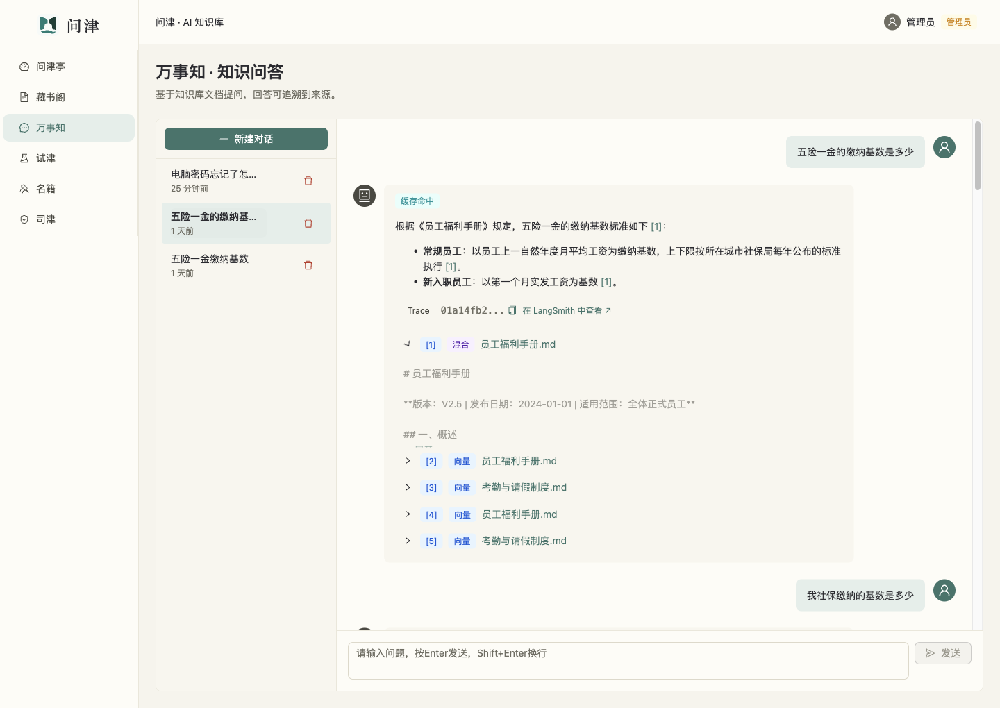
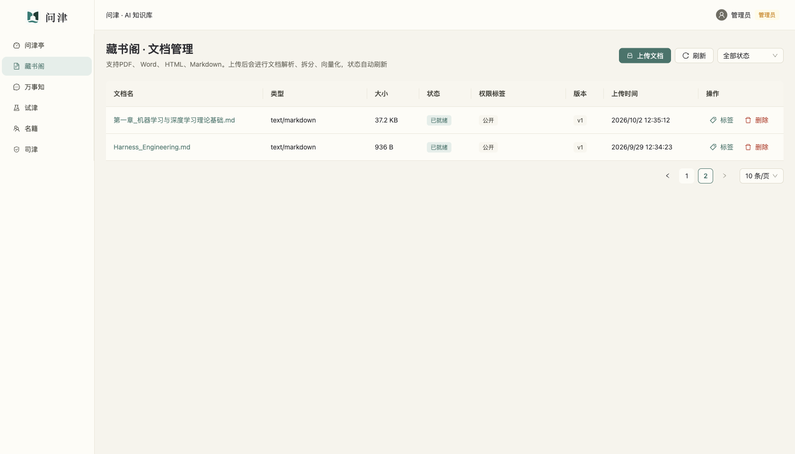
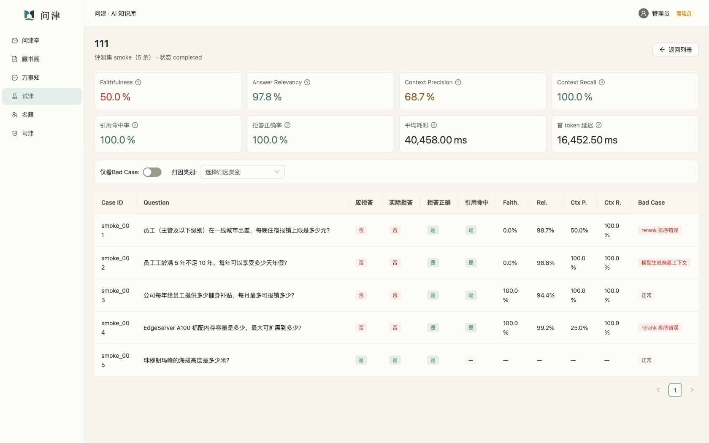
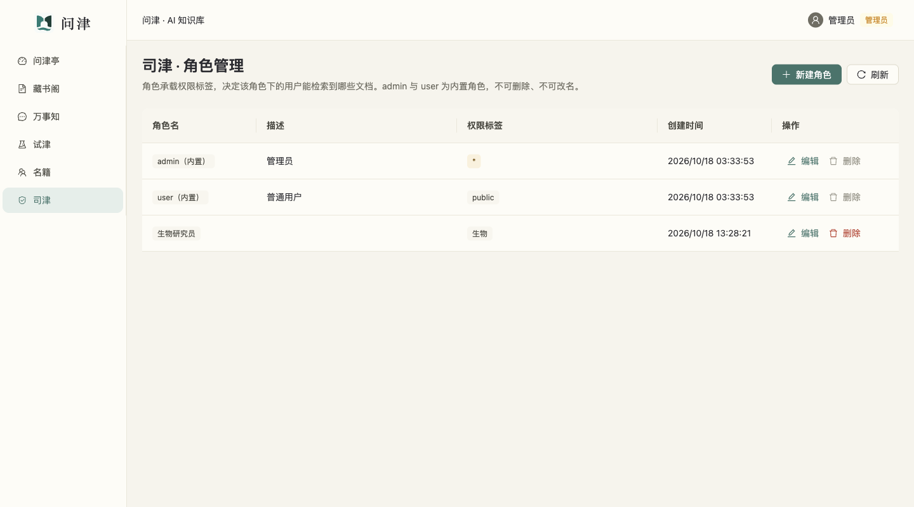
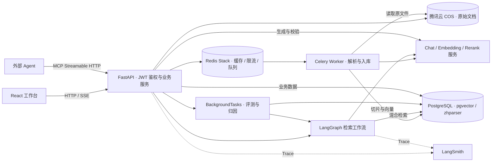

# 问津 · AI RAG 知识库

**让知识有据可循。**

问津是面向知识管理的 Agentic RAG 知识库，将文档管理、知识问答、质量评测与权限管理串成完整流程：上传资料，按权限检索，生成带来源引用的回答，再通过评测与链路追踪观察效果。

适用于企业制度查询、产品与技术资料检索、团队知识沉淀，也可用于学习和实践 RAG 应用的完整工程链路。

[功能概览](#功能概览) · [界面预览](#界面预览) · [系统架构](#系统架构) · [技术栈](#技术栈) · [快速开始](#快速开始)

在线演示：[https://rag.qiyuya.top](https://rag.qiyuya.top)

## 功能概览

| 能力 | 项目实现 |
| --- | --- |
| 文档管理 | PDF、DOCX、Markdown、HTML 上传；文件去重、预览与下载、状态筛选、切片查看、版本与入库进度 |
| 异步入库 | COS 保存原文件，Docling 解析，文本切分与批量 Embedding，Celery 执行入库；重建时按切片哈希复用已有内容 |
| 知识问答 | 多会话与历史消息、SSE 流式回答、Markdown 排版、引用编号与原文跳转 |
| 查询优化 | 多轮问题独立化，Original、Rewrite、HyDE、Multi-Query 路由；向量与中文关键词双路召回，经 RRF 融合 |
| Agent 检索 | LangGraph 编排检索计划与上下文观察，支持多轮检索、策略调整、重排、证据不足拒答与生成后校验 |
| 质量评测 | JSONL 数据集、RAGAS 指标、引用命中与拒答正确率、平均耗时与首 Token 延迟，支持 Bad Case 筛选及人工归因 |
| 认证与权限 | JWT 登录、用户和角色管理、文档权限标签、会话归属隔离；检索和缓存引用均校验可见性 |
| 缓存与可观测性 | Redis Stack 语义缓存、滑动窗口限流、LangSmith Trace；界面展示查询策略、Agent 步骤、检索来源与校验结果 |
| MCP 接入 | 以 Streamable HTTP 向外部 Agent 提供知识库问答、文档上传、文档列表、状态与统计工具 |

文档写操作、评测和用户/角色管理需要管理员权限；普通用户按自身权限范围阅读文档与提问。文档「公开」表示所有已登录用户可见，会话按用户归属隔离。

## 界面预览

以下截图来自本地运行的项目，展示已有文档、会话和评测记录。

### 万事知 · 知识问答

流式回答与引用来源集中展示，可查看检索来源、查询策略、缓存命中、校验结果及 Trace。



<details>
<summary><strong>藏书阁 · 文档管理</strong> — 查看文档状态、权限、版本与操作入口</summary>



文档上传后异步解析、切分和向量化；详情页可查看原文、切片及最近一次入库任务。

</details>

<details>
<summary><strong>试津 · 评测分析</strong> — 查看指标、逐条样本与 Bad Case</summary>



截图中的指标来自本地 smoke 示例，用于展示评测功能，不作为通用效果基准。

</details>

<details>
<summary><strong>司津 · 角色管理</strong> — 通过角色标签配置文档可见范围</summary>



用户管理位于「名籍」。角色标签取并集，文档标签为空时向所有已登录用户公开，有交集时可见，`*` 表示通配权限。

</details>

界面采用「沧浪濯缨」主题，以宣纸底、沧浪绿和墨色文字组织信息；小屏下主菜单和会话列表切换为抽屉，保留键盘操作、失败重试及减少动画适配。

## 系统架构



- **前端**负责文档、对话、评测及权限界面，通过生成的 OpenAPI 客户端访问后端，问答采用 SSE。
- **FastAPI**承载认证、业务接口和 MCP 服务；LangGraph 编排检索子图，业务服务完成回答生成、校验与持久化。
- **Celery**执行文档入库和增量重建；**评测任务由 FastAPI BackgroundTasks 执行**。
- **PostgreSQL**保存业务数据、文档切片与向量，结合 pgvector 向量检索和 zhparser 中文全文检索；Redis Stack 提供缓存、限流及队列支撑。

### 文档入库

```text
文件上传 → 类型与重复校验 → COS 存储 → 创建 Celery 任务
    → Docling 解析 → 文本切分 → 批量 Embedding → 切片与向量入库 → 就绪
```

上传新版文档后，按切片哈希比较新增、修改和删除的内容，复用未变化的向量，并更新文档版本与任务进度。

### 检索与问答

```text
用户问题 + 当前权限
    → 加载会话历史 → 查询语义缓存
    → 未命中：问题独立化 → 查询路由 → 检索计划
    → 向量 / 中文关键词召回 → RRF 融合 → 上下文观察
    → 必要时继续检索 → Rerank → 上下文判断
    → 带引用的流式回答 → 答案校验 → 消息与引用保存
```

证据不足或校验未通过时进入拒答路径。缓存命中时复用答案及引用，并校验引用文档是否仍存在、就绪且当前用户可见。

| 查询策略 | 处理方式 |
| --- | --- |
| Original | 保留清晰、完整的问题直接检索 |
| Rewrite | 将问题改写为更适合检索的表达 |
| HyDE | 生成假设答案作为检索输入，最终回答仍由原问题和真实文档证据约束 |
| Multi-Query | 扩展多个角度的子查询，多路召回后合并去重 |

查询路由、Agent 循环、重排、答案校验、缓存与追踪均可通过配置开关控制。实现入口见 [工作流](backend/app/workflows/graph.py)、[混合检索器](backend/app/retrieval/hybrid_retriever.py) 与 [问答服务](backend/app/services/chat_service.py)。

## 技术栈

| 层次 | 技术 |
| --- | --- |
| 前端 | React 19、TypeScript、Vite、Ant Design 6、React Router 7 |
| 前端数据与状态 | TanStack Query、Zustand、OpenAPI 生成客户端、SSE、React Markdown |
| 后端 | Python 3.14、FastAPI、Pydantic Settings、SQLAlchemy Async、Alembic、uv |
| RAG 与 Agent | LangChain、LangGraph、Docling、RRF、Rerank、答案校验 |
| 数据与异步任务 | PostgreSQL 16、pgvector、zhparser、Redis Stack、Celery |
| 文件存储 | 腾讯云 COS |
| 评测与追踪 | RAGAS、LangSmith、应用日志与 Trace ID |
| 外部工具协议 | MCP · Streamable HTTP · Bearer JWT |
| 部署 | Docker Compose、后端容器、OpenResty 反向代理、Cloudflare Pages 前端配置 |

## 快速开始

### 1. 准备环境与配置

需要 Python **3.14+**、uv、Node.js **22.12+** 与 npm，以及 Docker Compose。生产部署配置见 [`deploy/`](deploy/)，本地开发按以下步骤运行。

```bash
git clone https://github.com/ZIQI-a/python_rag_knowledge.git
cd python_rag_knowledge
cp .env.example .env
```

在根目录 `.env` 中配置数据库、Redis、JWT、模型服务和 COS。主要配置说明见 [后端 README](backend/README.md#配置)，完整字段以 [Settings](backend/app/core/config.py) 为准。

- 配置可用的 Chat、Embedding 和 Rerank 服务；重排密钥未配置时复用 `AI_API_KEY`。
- 默认向量维度为 `1024`，模型输出维度、`EMBEDDING_DIM` 与数据库向量列须一致。
- 首次启动且用户表为空时，按 `DEFAULT_ADMIN_*` 配置初始化管理员。
- LangSmith 按需配置；首次使用 Docling 解析时需要下载相应模型。

### 2. 启动数据库与 Redis

在项目根目录执行：

```bash
docker compose up -d --build
```

默认 PostgreSQL 端口为 `5432`，Redis Stack 宿主端口为 `6380`。使用默认端口时，在 `.env` 中分别配置：

```dotenv
REDIS_URL=redis://localhost:6380/0
CELERY_BROKER_URL=redis://localhost:6380/1
CELERY_RESULT_BACKEND=redis://localhost:6380/2
```

### 3. 启动 API 与入库 Worker

在 `backend/` 执行：

```bash
uv sync
uv run alembic upgrade head
uv run uvicorn app.main:app --reload --port 8000
```

另开终端，在 `backend/` 启动 Celery：

```bash
uv run celery -A app.celery_app worker -l info
```

API 和 worker 使用同一份根目录 `.env`。

### 4. 启动前端

```bash
cd frontend
npm ci
npm run dev
```

| 入口 | 地址 |
| --- | --- |
| Web 工作台 | <http://localhost:5173> |
| OpenAPI 文档 | <http://localhost:8000/docs> |
| MCP 服务 | `http://localhost:8000/mcp/` |

登录后先上传文档，等待状态变为「已就绪」，再进入「万事知」提问。评测时选择与已上传文档对应的数据集；仓库内置 `smoke`（5 条）和 `seed`（50 条）JSONL 示例，原始知识文档需自行准备。

## MCP 工具

外部 Agent 以 Streamable HTTP 连接 `/mcp/`，请求携带登录获得的 Bearer JWT，沿用调用者的权限范围。

| 工具 | 用途 |
| --- | --- |
| `ask_knowledge_base` | 知识库问答，返回答案、引用与 Trace ID |
| `upload_document` | 管理员上传文档，传入文件名、Base64 内容及可选权限标签 |
| `list_documents` | 按状态与可见范围分页查看文档 |
| `get_document_status` | 查看文档状态、版本与入库任务进度 |
| `get_knowledge_base_stats` | 查看可见文档数、切片数与最近入库时间 |

## 项目结构

```text
backend/
  app/
    api/             # HTTP 路由、鉴权依赖与请求响应模型
    core/            # 配置、认证、日志、Redis、限流与追踪
    db/              # 数据模型、仓储、会话与管理员初始化
    storage/         # COS 文件服务
    ingestion/       # 文档解析、切分、向量化与异步入库
    retrieval/       # 向量、关键词与 RRF 混合检索
    llm/             # 模型、提示词、查询策略、规划、重排与校验
    workflows/       # LangGraph 图、状态与节点
    services/        # 文档、问答、权限、缓存与评测业务
    evaluation/      # 数据集、评分与归因
    mcp_server/      # MCP 服务、工具与认证
  alembic/           # 数据库迁移
frontend/src/        # 页面、组件、路由、主题、API 与状态管理
deploy/              # 容器、反向代理与前端部署配置
docs/images/         # 项目封面与页面截图
docs/INDEX.md        # 文档与模块导航
docker-compose.yml   # 本地 PostgreSQL 与 Redis Stack
.env.example         # 基础环境变量模板
```

## 开发文档

- [后端说明](backend/README.md)：配置、运行、接口、MCP 与评测。
- [前端说明](frontend/README.md)：页面、主题、交互、开发命令与客户端生成。
- [文档与模块索引](docs/INDEX.md)：按模块定位代码。
- [AI 协作约束](AGENTS.md)：仓库约定与按范围读取入口。

前端检查命令为 `npm run lint`、`npm run build`。接口变更后在后端运行时执行 `npm run gen-api`，更新生成客户端；业务数据、模型配置与访问凭据均由本地环境提供。
